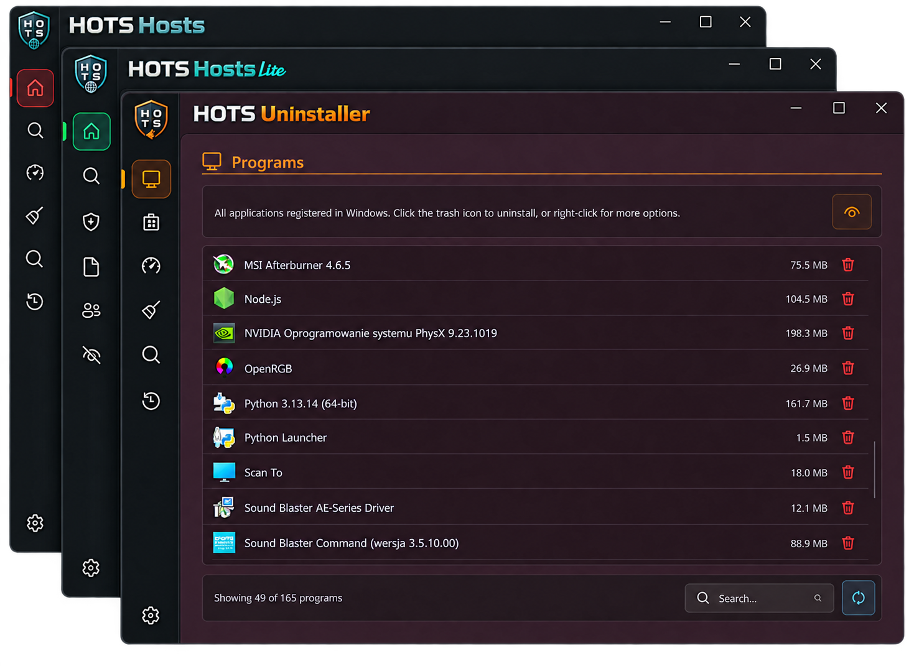
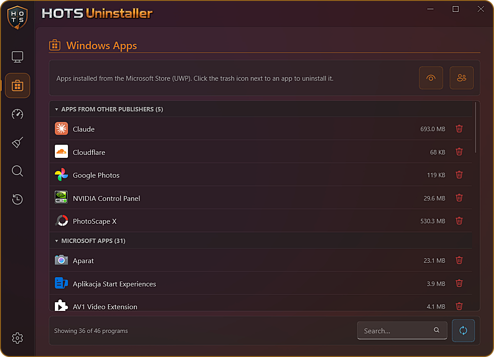
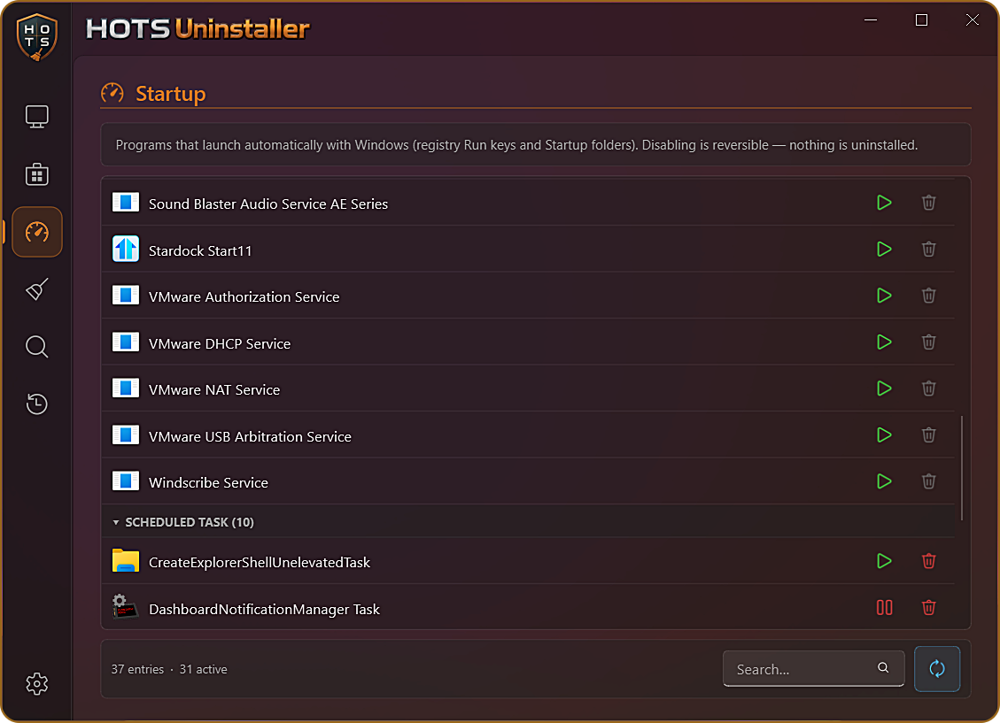
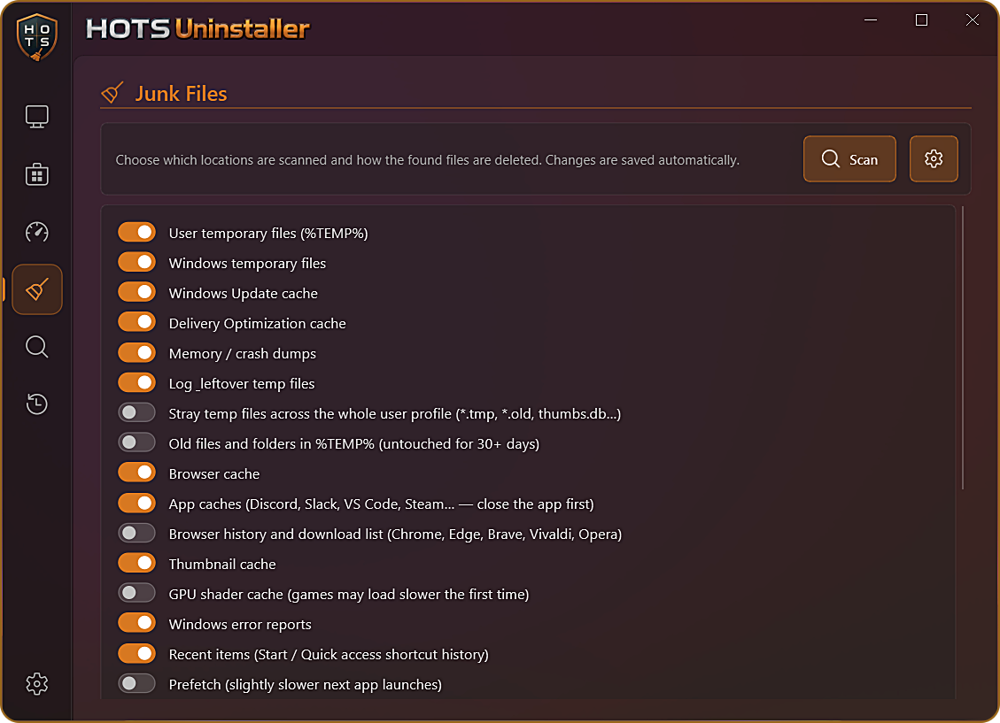
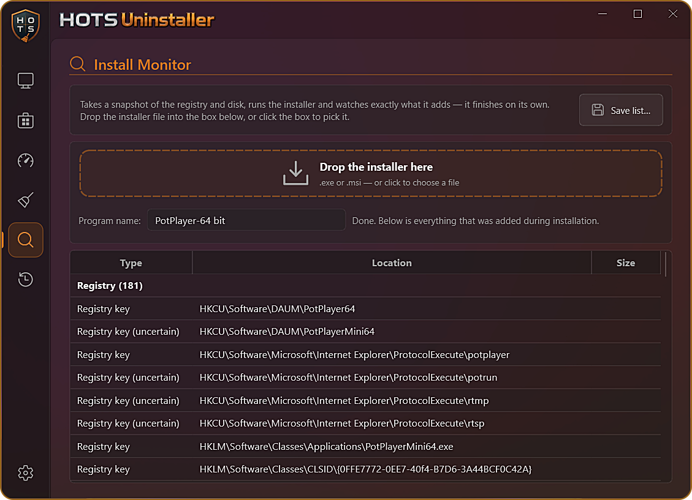
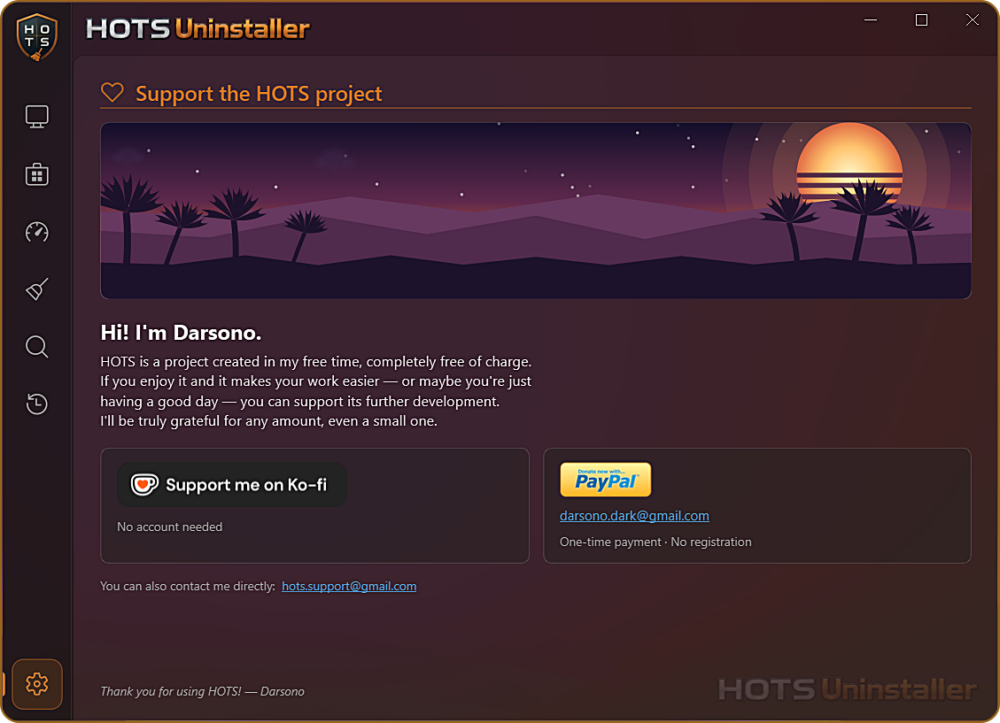

<div align="center">

# HOTS Uninstaller

**Remove programs completely — including the leftovers — and keep your Windows tidy. Free, lightweight, no bloat.**

[](https://www.gnu.org/licenses/gpl-3.0)
[](https://github.com/)
[](#language-support)

### 🚧 First release coming soon

*No account, no subscription, no ads. The download will appear here — preview and details at **[hotstools.com/uninstaller](https://hotstools.com/uninstaller/)**.*

<!-- When 1.0 is published, replace the "coming soon" block above with the download button:

### 📥 [⬇️ Download for Windows — free](https://github.com/darsono6/HOTS-Uninstaller/releases/latest/download/HOTS_Uninstaller_setup.exe)

*No account, no subscription, no ads. Just download and run.*
-->



</div>

---

## What does it actually do?

Windows' own "uninstall" removes a program and quietly leaves the rest behind: folders in AppData, registry keys, services, shortcuts. HOTS Uninstaller does the whole job:

- 🗑️ **Uninstall properly** — runs the program's own uninstaller, then scans for the files and registry entries it left behind and lets you review and remove them.
- 🔍 **Install Monitor** — records exactly what an installer adds to your system *before* you need to uninstall it, so the later cleanup is precise instead of guesswork.
- 🧹 **Keep Windows clean** — manage startup entries, remove Microsoft Store apps, and clear junk files, all from one window.

Nothing is deleted behind your back: every cleanup shows you a list first, and registry keys are backed up before they are removed.

---

## Getting started

> 🚧 **Not released yet.** The first public release (1.0) is on its way, and this section goes live with it. Until then, see the [preview page](https://hotstools.com/uninstaller/).

Once it's published:

1. Download the installer from the [Releases page](https://github.com/darsono6/HOTS-Uninstaller/releases/latest)
2. Double-click it — Windows will ask for Administrator permission (that's normal, the app needs it to remove programs and edit the registry)
3. Follow the setup wizard — done

**Requires:** Windows 10 or 11, 64-bit.

### About the Windows warning you might see

Since this is a small independent project without a paid certificate, Windows may show a **"Windows protected your PC"** warning the first time you run it. This is normal for any new app that hasn't built up a download history yet — it does **not** mean anything is wrong with the file.

To continue: click **More info** → **Run anyway**.

If you'd rather double-check the app yourself first, the full source code is right here in this repository — see [Running from source](#running-from-source) below.

---

## What's new in 1.0

First public release.

- **Programs** — full list of installed programs with search and sorting, native one-click uninstall, leftover scan, and forced removal of broken ("ghost") entries
- **Windows Apps** — uninstall Microsoft Store (UWP) apps, with warnings for core Windows components
- **Startup** — see everything that launches with Windows and switch it off (reversibly) or remove it
- **Junk Files** — 19 categories of junk, nothing deleted until you confirm
- **Install Monitor** — before/after snapshot of the registry and disk; the result is used automatically when you later uninstall that program
- **Registry Backups** and **uninstall history** — restore a removed key if something turns out to be needed
- 5 languages, dark and light theme, 5 accent colors

---

## Everything it can do

<details>
<summary><strong>🗑️ Programs &amp; Uninstalling</strong> — click to expand</summary>

- **Full list of installed programs** — name, publisher, version, size and install date, with live search and sorting. Recently installed programs are grouped at the top
- **Native uninstall, one click** — launches the program's own uninstaller, with an optional system **restore point** created first (on by default)
- **Leftover scan** — after uninstalling, finds folders, files, registry keys, services and shortcut-history entries that probably belong to the program. You choose what to delete
  - Nothing is selected for you, and the select-all button ticks only the high-confidence items. Items with no independent link to the program are marked **uncertain**, and **user data** (bookmarks, passwords) is flagged separately; both have to be ticked by hand
  - Protected system folders and registry keys, links/junctions, and files belonging to other installed packages are skipped
  - Files that are in use are scheduled for deletion on the next restart
  - Every registry key is backed up before it is removed
- **Forced removal of ghost entries** — programs whose uninstaller no longer exists (the entry is still in the list, the files are gone) can be cleaned out. Only the registry entry is removed, with a backup, and the leftover scan runs first
- **Protected and hidden components** — system components and sub-packages are hidden unless you choose to show them, and carry a warning
- **Right-click menu** — open the install location, jump to the registry entry, copy the path, view properties, or search the name online
- **Remove portable programs** — a "Remove with HOTS" action for standalone `.exe` files cleans up the file and its traces (shortcuts, Prefetch, registry history) without touching the folder it sits in. The installer can also add it to Explorer's right-click menu (an optional setup choice, off by default)

</details>

<div align="center">

<br/><sub>Windows Apps — Microsoft Store apps in one list</sub>
</div>

<details>
<summary><strong>🪟 Windows Apps</strong> — click to expand</summary>

- Lists apps installed from the Microsoft Store, grouped into Microsoft apps and other publishers
- Uninstall with one click; protected system apps are clearly marked and can't be removed
- Optional toggle to show hidden components and apps installed for other user accounts
- Warnings for background components, extension packages and core Windows parts that can affect other things if removed

</details>

<div align="center">

<br/><sub>Startup — everything that launches with Windows, switched off reversibly</sub>
</div>

<details>
<summary><strong>🚀 Startup Manager</strong> — click to expand</summary>

- Shows everything that starts with Windows: registry Run keys, the user and all-users Startup folders, scheduled tasks, services and Store app startup tasks
- **Disable and enable** without uninstalling anything — it uses Windows' own startup switch, so the setting stays as you left it
- **Remove** entries permanently (services can only be switched on/off — removing them is deliberately not offered)
- Notes for entries enforced by Group Policy or set to run only once, so a re-appearing entry doesn't surprise you

</details>

<div align="center">

<br/><sub>Junk Files — choose which locations are scanned; nothing is deleted until you confirm</sub>
</div>

<details>
<summary><strong>🧹 Junk Files</strong> — click to expand</summary>

- **19 categories**, including user and Windows temp files, Windows Update and Delivery Optimization cache, crash dumps and error reports, logs, browser cache, thumbnails, Prefetch, GPU shader cache, app caches (Discord, Slack, VS Code, Steam…), the Recycle Bin and old files in `%TEMP%`
- **Opt-in extras** with clear warnings: browser history and download lists (Chrome, Edge, Brave, Vivaldi, Opera), the previous Windows installation (`Windows.old`), and old system restore points (the newest is always kept)
- **Nothing is deleted automatically** — you scan, review and confirm
- Optional **Recycle Bin mode** instead of permanent deletion (cache-type items are always removed permanently, and the app says so)
- Files in use and protected locations are skipped, and a summary shows the space freed

</details>

<div align="center">

<br/><sub>Install Monitor — everything an installer added to the registry and disk</sub>
</div>

<details>
<summary><strong>🔍 Install Monitor</strong> — click to expand</summary>

- Drop an installer (`.exe` or `.msi`) onto the window, or pick it with a click. The app takes a snapshot of the registry and disk, starts the installer, and **finishes on its own** when the installation settles. You can also finish manually at any time
- Records what the installation added: registry keys and values, files and folders, services, scheduled tasks, and the install folder when it lives outside the usual locations (for example on another drive)
- Background noise from Windows itself (Explorer history, caches, update state and so on) is filtered out
- The result is saved as a **monitoring log** tied to the program and used automatically when you later uninstall it — programs installed this way carry an "Installed with Install Monitor" badge
- Export the list to a text file
- The installer is checked before it runs: local `.exe`/`.msi` files only (no shortcuts, links or network paths), a valid file header, and the file must not change while the snapshot is taken

</details>

<details>
<summary><strong>💾 Registry Backups &amp; History</strong> — click to expand</summary>

- Every registry key removed as a leftover is backed up first — restore it with one click if it turns out you needed it
- Backups are integrity-checked; one that has been altered or comes from an older version won't be restored
- Up to 50 backups are kept (the oldest are removed automatically)
- **Uninstall history** — programs removed through the app, with their logs, kept for 3 months

</details>

<details>
<summary><strong>🎨 Other features</strong> — click to expand</summary>

- Light and dark themes, 5 accent colors (yellow, red, green, blue, orange), custom window with Mica backdrop on Windows 11
- 5 languages: English, Polski, Français, Deutsch, Español — the app starts in your Windows language when it is supported
- Built-in update checker (checks GitHub Releases on startup — can be switched off in **Options → About**)
- Uninstall wizard for the app itself — choose whether to keep or delete its saved settings, history, monitor logs and registry backups
- Auto-elevation, single-instance guard, window size and position memory

</details>

---

## Safety

An uninstaller runs with administrator rights and deletes things, so the app is deliberately cautious:

- Nothing is removed without a review step and your confirmation
- Registry keys are backed up before deletion, and backups are integrity-checked before they can be restored
- System-critical folders and registry keys are always off-limits, as are links and junctions
- Nothing is pre-selected, and items that are only *possibly* related are never included by the select-all button
- System services are never touched; a leftover service is removed only if it is an application service whose program file no longer exists
- The data folder, backups and logs are validated before the elevated app reads or deletes anything, so another program can't redirect it to other files
- The only network request the app makes on its own is the update check against GitHub Releases (on by default, can be switched off in **Options → About**). There is no telemetry, no account and no ads

That said, removing the wrong thing can still break a program. Keep the restore-point option on for anything important.

---

## Part of HOTS Tools

HOTS Uninstaller is one of the small, independent [HOTS Tools](https://hotstools.com) for Windows, built by one person: **[HOTS Hosts](https://github.com/darsono6/HOTS)** (hosts file editor with parental controls and Windows privacy tools) and **[HOTS Hosts Lite](https://github.com/darsono6/HOTS-Hosts-Lite)** (a lighter hosts editor with profiles, firewall blocking and network tests).

---

## Running from source

<details>
<summary>For developers — click to expand</summary>

**Requirements:** Python 3.10+, `PySide6` and `certifi` (see `requirements.txt`)

```bash
git clone https://github.com/darsono6/HOTS-Uninstaller.git
cd HOTS-Uninstaller
pip install -r requirements.txt
pythonw hots_uninstaller_launcher.pyw
```

> Run the launcher, not `python -m hots_uninstaller` directly — `hots_uninstaller_launcher.pyw` is what handles the single-instance guard and requests Administrator rights via UAC. Without that elevation the app can't uninstall programs or change protected registry keys.

### Project structure

```
hots_uninstaller_launcher.pyw   # Single-instance guard + admin elevation + uninstall modes (build target)
hots_uninstaller/
├── __main__.py             # Entry point — error log, splash screen, app startup
├── app.py                  # Main window — navigation, update check, portable-removal requests
├── frameless.py            # Custom window shell — title bar, DWM shadow, Mica (Win11), page stack
├── nav_rail.py             # Side navigation rail
├── core_uninstall.py       # Installed-program list, native uninstall, leftover scan and removal, registry backups, history
├── core_appx.py            # Microsoft Store (UWP) apps — listing and removal
├── core_startup.py         # Startup entries — registry, folders, scheduled tasks, services, Store apps
├── core_junk.py            # Junk file categories — scan and cleanup
├── core_monitor.py         # Install Monitor — snapshots, comparison, logs
├── core_portable.py        # "Remove with HOTS" for portable .exe files
├── uninstall_flow.py       # Cleanup logic when HOTS Uninstaller itself is uninstalled
├── app_icons.py            # Program icon extraction
├── bg_tasks.py             # Background worker thread registry — joined on app quit
├── proc_utils.py           # Helpers for starting external processes safely
├── constants.py            # Theme colors, accent presets, paths, settings load/save
├── widgets_qt.py           # Reusable Qt UI components — buttons, dialogs, pages, tooltips
├── ui_parts.py             # Small widgets — info banner, progress parts
├── hover_help.py           # Hover help tooltips
├── icons.py                # Built-in SVG icon set
├── resource_utils.py       # Base-path resolution (dev / frozen builds)
├── win_icon.py             # Window icon applied through the Win32 API
├── i18n.py                 # Multilingual string system (EN / PL / FR / DE / ES)
├── graphic/                # Logos, window icon, splash image, donate buttons
└── dialogs/
    ├── programs_page.py        # Installed programs list
    ├── appx_page.py            # Windows Apps
    ├── startup_page.py         # Startup manager
    ├── junk_page.py            # Junk files
    ├── monitor_page.py         # Install Monitor
    ├── backups_page.py         # Registry backups and uninstall history
    ├── leftover_dialog.py      # Leftover review window
    ├── uninstall_wizard.py     # Uninstall flow for other programs and Store apps
    ├── summary_dialog.py       # Result summary
    ├── self_uninstall_wizard.py  # Uninstall-time wizard for HOTS Uninstaller itself
    ├── language_dialog.py      # Language selection
    ├── accent_dialog.py        # Accent color picker
    ├── support_page.py         # Support / donate window
    ├── about_page.py           # About & update checker
    └── _*.py                   # Shared/internal helpers for the pages above
```

</details>

---

## Language support

The interface language can be changed in **Options → Language** (a restart applies the change). All UI strings and dialogs are fully translated.

| Code | Language |
|------|----------|
| `en` | English (default) |
| `pl` | Polski |
| `fr` | Français |
| `de` | Deutsch |
| `es` | Español |

---

## Third-party components

- [PySide6](https://doc.qt.io/qtforpython-6/) (Qt for Python) — LGPLv3 / GPLv3
- [certifi](https://github.com/certifi/python-certifi) — MPL 2.0
- Icons: [Fluent UI System Icons](https://github.com/microsoft/fluentui-system-icons) © Microsoft Corporation — MIT (license text kept in `hots_uninstaller/icons.py`)

---

## Disclaimer

HOTS Uninstaller is provided in good faith but **without any warranty**. The author is **not responsible** for any damage, data loss, system issues, or other consequences resulting from the use of this application. Uninstalling programs and deleting files and registry entries can affect how Windows and other software work — review every list before you confirm, and use the restore-point option for anything important. You use this software **at your own risk**.

---

## Bug reports

Found a bug? Open an [issue](https://github.com/darsono6/HOTS-Uninstaller/issues/new/choose) — the form asks for everything needed to reproduce it. The app also keeps a log at `%APPDATA%\HOTS Uninstaller\error.log`, which is helpful to attach.

---

## Security

Found a security issue? Please report it privately rather than opening a public issue — see **[SECURITY.md](SECURITY.md)** for how to report and what's in scope.

---

## Support

If HOTS Uninstaller saves you time or you simply want to say thanks:

<a href="https://ko-fi.com/darsono"></a>

**Website:** [hotstools.com](https://hotstools.com)
**Ko-fi:** [ko-fi.com/darsono](https://ko-fi.com/darsono)
**PayPal:** [paypal.me/darsonodark](https://paypal.me/darsonodark)
**Support:** hots.support@gmail.com

No registration required. Any amount is appreciated.

<div align="center">

</div>

---

## License

[GNU General Public License v3.0](LICENSE.txt)
© 2026 Darsono
